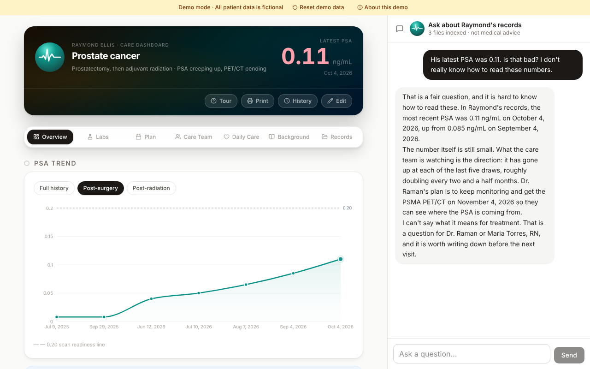

# Care Dashboard (Demo)

A web dashboard that helps a family track a loved one's cancer care in one place, with AI help for reading medical documents.

> This repository is a showcase of example work. It is a demo-only copy of a private app I built for a family member's cancer care, stripped of all real data, credentials, and personal information. Every patient, clinician, and value shown here is fictional.



## What it does

- PSA trend chart with doubling time
- Care plan, care team, and medications
- Labs, tracked over time
- AI document extraction into reviewable suggested updates
- AI visit-prep briefs, streamed as they are written
- AI chat over the record, plus edit history with undo

The sample documents (Records tab) work without a key, so you can try extraction right away.

## Tech

React 19, TypeScript, Vite, TanStack Router and Query, Tailwind, Recharts, Supabase (Postgres and edge functions), Anthropic API, Vitest, Playwright.

## Run it

```sh
bun install && bun run dev
```

This starts the dev server in demo mode, with seeded, fictional data stored in your browser. Chat, visit prep and extraction from your own uploads need your own Anthropic API key, which stays in the browser tab and is sent only to Anthropic. In the demo, your own uploads are read as text, so use .txt, .md or .csv files; the sample documents need no key.

## Full stack (optional)

The original runs on Supabase. To try it with the local Supabase stack (`supabase start`):

1. Copy `.env.example` to `.env`, set `VITE_DEMO_MODE=false` and fill in the Supabase URL and publishable key.
2. Run `bun run db:reset`. It generates the gitignored `supabase/seed.sql` and resets the local database, applying `supabase/migrations` and the seed.
3. Set the edge-function secrets (`supabase secrets set`, or `supabase/functions/.env` locally). Required: `APP_PASSWORD` (the dashboard password), `ANTHROPIC_API_KEY`, and `ALLOWED_ORIGIN` (the app's URL; without it CORS allows any origin). Optional: `PATIENT_FIRST_NAME`, `APP_NAME`, `SURGERY_DATE`, `RADIATION_END_DATE`, and `RESEND_API_KEY`, `NOTIFY_EMAIL`, `CRON_SECRET` for the appointment email.
4. Deploy the edge functions with `supabase functions deploy` (or run them locally with `supabase functions serve`).

Real mode also needs `VITE_AUTH_EMAIL`: create one Supabase auth user (for example `demo@example.com`) whose password is the dashboard password; the app signs in as that user.

## Not medical advice

Nothing here is medical advice. Talk to a clinician about real decisions.
